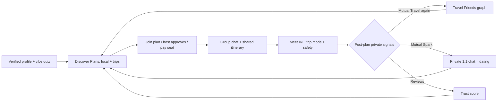
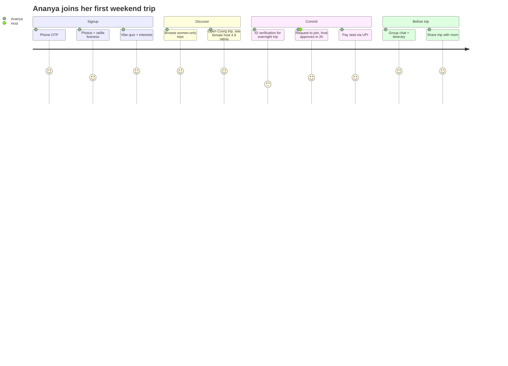
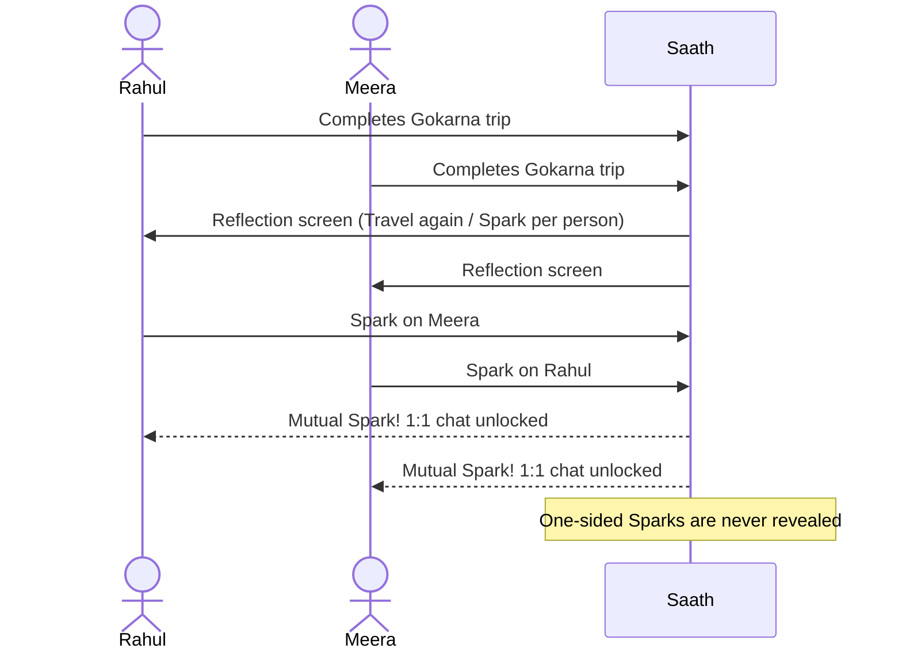
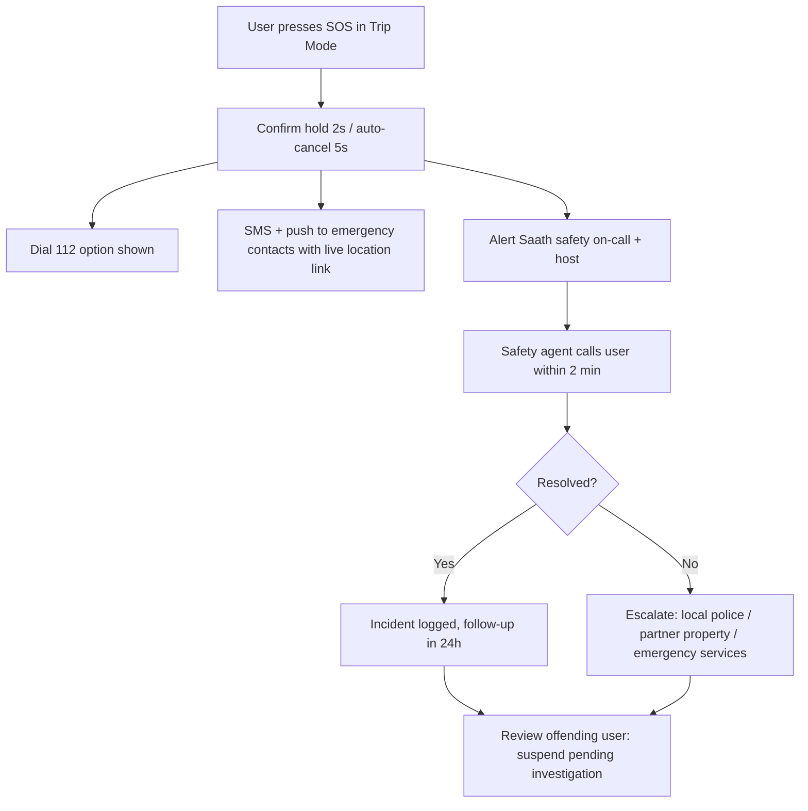
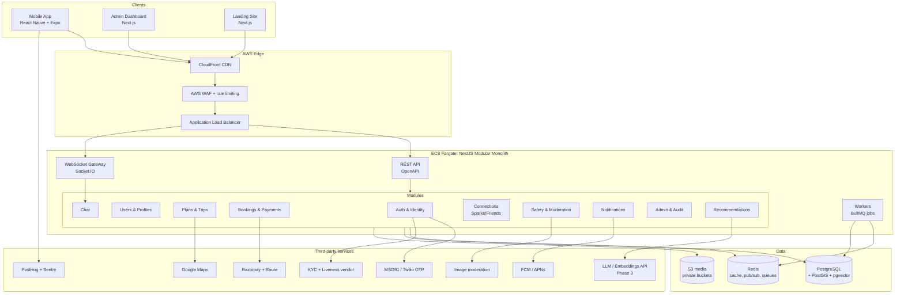
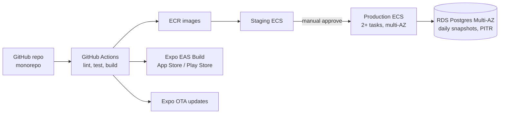
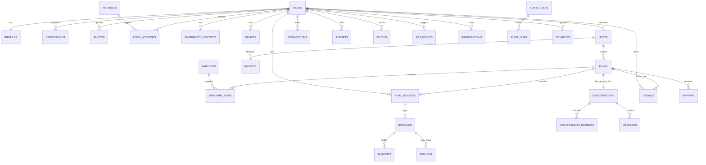
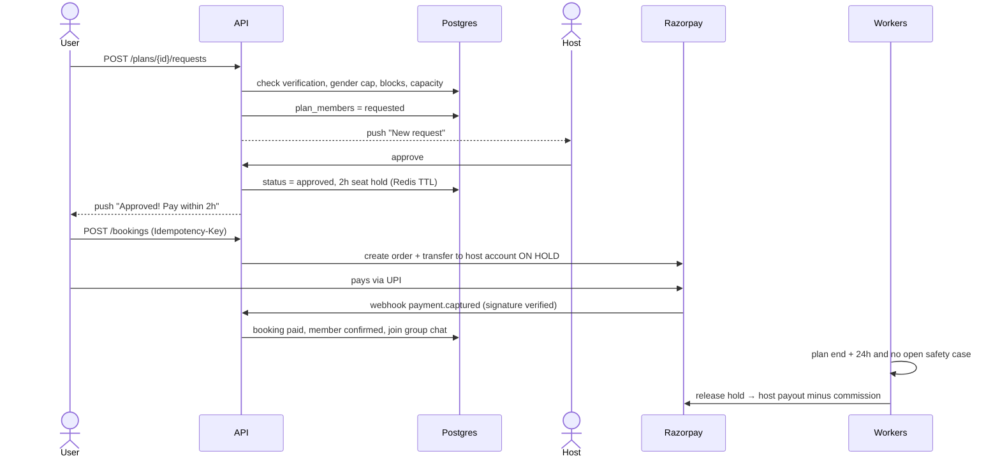
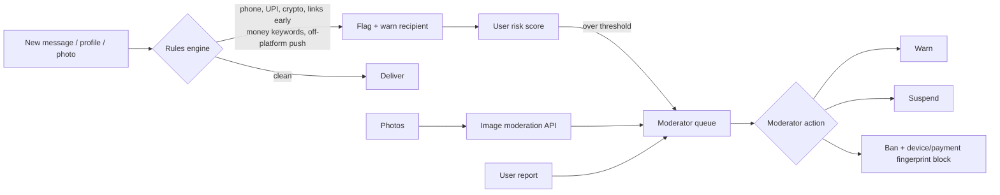
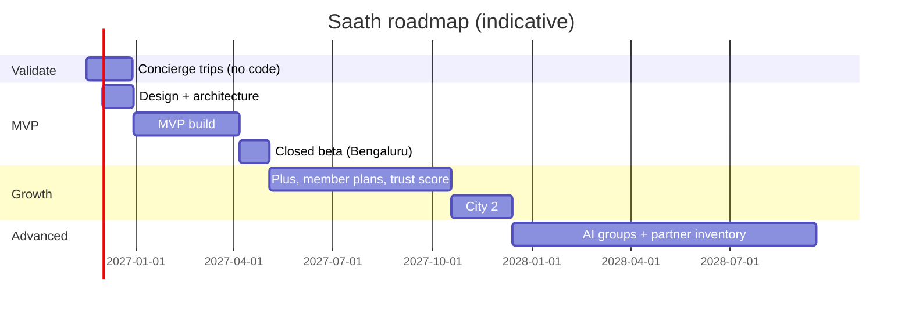

# Dating + Travel Platform — Founder Execution Blueprint

> **Working name:** *Saath* ("together" in Hindi). Placeholder only. Run a trademark and app-store name check before using it.
> **Prepared:** 14 November 2026 · **Launch market assumed:** India (Bengaluru first) · **Team assumed:** 2–4 engineers, pre-seed/bootstrap budget
> **Document type:** Strategy + product + architecture blueprint. Every claim is tagged so you know how much to trust it.

---

## How to read this document

| Tag | Meaning | How much to trust it |
|---|---|---|
| ✅ **FACT** | Verified from a cited, dated source (SEC filing, company newsroom, named survey) | High. Still re-check numbers before quoting to investors. |
| 🧪 **HYPOTHESIS** | A belief we must test with real users before betting money on it | Medium/Low until validated |
| 🎯 **RECOMMENDATION** | My opinionated advice as strategist/architect | Judgment call. Challenge it. |
| ⚠️ **ESTIMATE** | Cost/price/number based on assumptions, not quotes | Get vendor quotes before budgeting |

---

## Table of Contents

0. [Executive Summary & Brutally Honest Verdict](#0-executive-summary--brutally-honest-verdict)
1. [Market Research Findings](#1-market-research-findings)
2. [Competitor Comparison Matrix](#2-competitor-comparison-matrix)
3. [Top 10 Validated Market Gaps](#3-top-10-validated-market-gaps)
4. [Recommended Product Concept & Differentiation](#4-recommended-product-concept--differentiation)
5. [Complete Feature List with Priorities](#5-complete-feature-list-with-priorities)
6. [UI/UX Screens & User Journeys](#6-uiux-screens--user-journeys)
7. [System Architecture & Database Design](#7-system-architecture--database-design)
8. [Phase-wise Development Roadmap](#8-phase-wise-development-roadmap)
9. [Business & Monetization Strategy](#9-business--monetization-strategy)
10. [Launch & Marketing Strategy](#10-launch--marketing-strategy)
11. [Trust, Safety & Legal](#11-trust-safety--legal)
12. [Risks, Challenges & Mitigation](#12-risks-challenges--mitigation)
13. [Practical 90-Day Execution Plan](#13-practical-90-day-execution-plan)
14. [Source Index](#14-source-index)

---

## 0. Executive Summary & Brutally Honest Verdict

### The one-paragraph answer

Don't build "Tinder + a trip planner." The swipe market is shrinking. In India it is flooded with men. Pure travel-dating apps have stayed small for ten years. Build a **plans-first social platform** instead. Verified people join **small-group plans** (weekend trips, treks, day outings, dinners). Romance is an **opt-in outcome after meeting in real life**, not the main interaction. Make women's safety the product, not a feature. Make money from **trips that actually happen** (booking fees + partner commissions) plus a light membership, not from paywalls on swiping.

### Why the original idea, as stated, would likely fail

| Weakness | Why it matters | Evidence |
|---|---|---|
| Swipe dating is in structural decline | You'd be entering a shrinking pool against companies with $800M+ quarterly revenue | ✅ Match Group payers fell 6% Y/Y to 13.3M (Q2 2026); Bumble paying users fell 16.4% to 3.2M (Q2 2026) |
| Travel happens a few times a year | A trip-only app gets opened rarely, so retention collapses | 🧪 Inferred from trip frequency; must fill gaps with local weekly plans |
| India's gender ratio breaks dating apps | Without women, men churn; without trust, women never join | ✅ Sources disagree (62/38 to 93/7 male/female) but all agree it is heavily male-skewed |
| "Friends or dating?" ambiguity | Mixed-intent apps confuse users | 🧪 Fixed by design: intent is explicit and romance is opt-in after meeting |
| Group dinners with strangers already exist in Bengaluru | Timeleft already runs singles and women-only dinners | ✅ Timeleft operates in Bangalore, Hyderabad, Mumbai and New Delhi |

### What *can* win (the thesis)

1. **People want to meet through shared activities, not profiles.** Eventbrite says events using "meet-cute" language grew 117% in H1 2026. ✅
2. **Young Indians travel in groups and choose their companions carefully.** Airbnb: 3 in 4 Indian Gen Z say *who* they travel with matters more than *where*; group trips grew ~55% Y/Y. ✅
3. **Women's solo travel is growing fast but limited by safety.** Zostel solo-female bookings: 33,357 (2018) → 92,192 (2025). ~90% of women prioritise safety when choosing destinations. ✅
4. **Nobody owns "verified small-group *trips* with strangers who might become friends or partners" in India.** Timeleft owns city dinners. Zostel owns beds. Meetup owns interest groups. Tinder and Hinge own profiles. 🧪 This is our gap.

### Verdict

| Question | Answer |
|---|---|
| Is there a real problem? | **Yes.** People are tired of swiping, unsafe solo travel, and loneliness ✅ |
| Is "dating + travel" the right framing? | **No.** Reframe as "plans-first social discovery, romance optional" 🎯 |
| Venture-scale? | **Possibly.** Only if (a) local weekly plans drive retention and (b) the trips marketplace earns real take-rate revenue. Unproven 🧪 |
| Biggest risk | Running operations (hosts, vendors, safety incidents), not technology |
| Smartest first move | **Run 10–15 real trips manually with WhatsApp + Google Forms + Razorpay links before writing serious code** 🎯 |


---

## 1. Market Research Findings

### 1.1 The global dating market is shrinking in users but growing in revenue per user ✅

| Data point | Value | Source |
|---|---|---|
| Match Group Q2 2026 revenue | $853M, **−1% Y/Y** | [Match Group 8-K, Aug 2026](https://www.sec.gov/Archives/edgar/data/0000891103/000089110326000128/mtch8-k20260804ex991.htm) |
| Match Group payers | **13.3M, −6% Y/Y**; revenue per payer +6% to $21.13 | same |
| Payer decline streak | 5th consecutive quarter of contraction | [Investing.com slides summary](https://www.investing.com/news/company-news/match-group-q2-2026-slides-reveal-profitability-gains-amid-revenue-slip-93CH-4836218) |
| Tinder | Payers 8.5M, −5%; MAU −7% Y/Y | [Yahoo Finance call highlights](https://finance.yahoo.com/markets/stocks/articles/match-group-inc-mtch-q2-050208463.html) |
| **Hinge** (the exception) | Revenue **+22%** to $204M; payers +17% to 2M; MAU +13% | [Match Group 8-K](https://www.sec.gov/Archives/edgar/data/0000891103/000089110326000128/mtch8-k20260804ex991.htm) |
| Bumble Q2 2026 | Paying users **−16.4% to 3.2M**; revenue −15% | [Bumble 8-K Q2 2026](https://www.sec.gov/Archives/edgar/data/0001830043/000183004326000099/bmbl-ex991prxq22026.htm) |
| Bumble going private | $1.3B all-cash take-private by Ithaca Holdings (Oct 2026), vs ~$14B peak value in 2021 | [Bumble 8-K Oct 2026](https://www.sec.gov/Archives/edgar/data/0001830043/000095010326015480/dp254907_ex9901.htm), [GDI](https://www.globaldatinginsights.com/featured/bumble-ithaca-holdings-1-3-billion-acquisition/) |

**What this means:** Fewer people pay for swipe apps. The survivors earn more from each loyal payer. Hinge grows because it markets itself as *intentional*. **Lesson:** intent + quality beats volume. 🎯

### 1.2 People are exhausted by dating apps ✅

| Data point | Source |
|---|---|
| 78% of US dating-app users report burnout; **79% of Gen Z and Millennials** (Forbes Health/OnePoll, 1,000 users, 2024) | [Global Dating Insights](https://www.globaldatinginsights.com/news/new-forbes-study-explores-dating-app-burnout/) |
| Top causes: ghosting, catfishing, failing to find a good connection, repetitive small talk | [Forbes](https://www.forbes.com/sites/traversmark/2024/10/07/5-ways-to-recover-from-dating-burnout-explained-by-a-psychologist/) |
| ⚠️ US data only. No equally rigorous India burnout survey found. Treat India transfer as 🧪 | — |

### 1.3 Meeting through shared activities is surging ✅

| Data point | Source |
|---|---|
| Events using "meet-cute" language **+117%** in H1 2026 vs H1 2025, with large growth in singles trivia and hobby events | [Eventbrite Modern Meet-Cute Index](https://www.eventbrite.com/blog/press/newsroom/the-modern-meet-cute-index/) |
| Most young adults prefer socializing to be a *secondary* part of an experience (Eventbrite 2026 Social Study) | same |
| ⚠️ A trade outlet questioned the comparison baseline. The direction is credible; treat exact % with caution | [Dating Industry Insights](https://www.datingindustryinsights.com/news/hobby-events-massive-spike-dating-meetup) |
| Tinder itself launched IRL events (March 2026) to win back users. Incumbents validate the trend | [Business of Apps](https://www.businessofapps.com/data/dating-app-market/) |

**Key insight:** People prefer to meet **while doing something**, with romance as a possible by-product. A group trip is exactly that. 🎯


### 1.4 India: huge, growing, broken on gender and trust ✅

| Data point | Source |
|---|---|
| ~**205M dating app downloads in India in 2025**; market $547.9M (2023) → $1.02B by 2030 (Grand View Research, via GDI) | [GDI: India is Hinge's #2 market](https://www.globaldatinginsights.com/from-the-web/hinge-india-second-largest-market/) |
| India is Hinge's 2nd-largest market by downloads; Match Group plans to raise India marketing spend | same |
| Hinge India: Hinge+ ₹1,199/mo, HingeX ₹1,499/mo, so Indians *do* pay for intentional dating | same |
| Hinge added India-specific privacy: Face Check, screenshot protection, Block List (hide from family/colleagues) | same |
| Gender ratio estimates **conflict**: 62/38 M/F (Zippia), ~67% male (student market study), ~93/7 on Tinder India (Medium analysis) | [Zippia](https://www.zippia.com/advice/tinder-statistics/), [NextLeap PDF](https://assets.nextleap.app/submissions/IndiaDatingPlatformFeasibilityResearch_-accf218f-fecb-4057-9317-08fc8e87fa68.pdf), [Medium](https://medium.com/@vlncy/swipe-nation-what-the-data-actually-says-about-dating-in-india-3c9f9e23dabb) |
| Safety risk and social stigma deter Indian women (harassment, stalking, fear of being identified) | [Medium analysis](https://medium.com/@vlncy/swipe-nation-what-the-data-actually-says-about-dating-in-india-3c9f9e23dabb) |

**Honest read:** None of the gender-ratio sources is an official company disclosure. The ratio is clearly badly skewed, so **women-first trust design is non-negotiable**. 🎯

### 1.5 Indian Gen Z travel behaviour fits group plans ✅

From Airbnb's *Never the Same* report (2,012 respondents aged 18–29, 11 Indian cities), see [Airbnb Newsroom](https://news.airbnb.com/en-in/new-report-never-the-same-reveals-how-indias-gen-z-travels/) and [ThePrint](https://theprint.in/feature/airbnb-india-gen-z-travel-mini-vacations/2967418/):

- **3 in 4** say *who* they travel with matters more than *where*.
- **Group trips** grew **~55% Y/Y** domestically, the fastest-growing trip type.
- Strong preference for several short trips over one long holiday; most book within days or weeks.

**Implication:** Product unit = **2-night weekend trip, 4–8 people, booked 1–3 weeks ahead.** 🎯

### 1.6 Women's travel: big demand, safety is the bottleneck ✅

| Data point | Source |
|---|---|
| Zostel solo female bookings: 33,357 (2018) → **92,192 (2025)** | [First Resort research](https://www.firstresort.in/blogs/research/indian-women-travel-2026), [Curly Tales](https://curlytales.com/india/trending/solo-female-travel-surges-in-with-bookings-goa-jaipur-gokarna-top-picks/) |
| ~**90%** of women prioritise safety when choosing destinations; **59%** faced gender-based harassment while travelling in India (Outlook Traveller–Toluna) | [First Resort research](https://www.firstresort.in/blogs/research/indian-women-travel-2026) |
| NARI 2025 (12,770 women, 31 cities): ~4 in 10 urban women feel unsafe; transit/highways are hotspots | [Outlook Traveller](https://www.outlooktraveller.com/News/can-women-travel-safely-in-india-new-report-reveals-city-rankings) |
| Hostelworld 2025: majority of solo travellers are female; desire to meet new people rising sharply | [Hostelworld State of Solo](https://social.hostelworld.com/state-of-solo-travel) |

### 1.7 Scams are an industry-wide crisis ✅

- A US congressional (Joint Economic Committee) investigation found **~1.5M scammer/bad-actor accounts** on Tinder and Hinge matched with at least one US user in the first nine months of 2025 ([ConsumerAffairs](https://www.consumeraffairs.com/news/senate-probe-finds-major-gaps-in-tinders-protection-against-romance-scams-101526.html), [NBC News](https://www.nbcnews.com/tech/tech-news/romance-scammers-congressional-investigation-match-group-tinder-rcna602411)).
- Match responded with mandatory biometric Face Check for new users.
- The US Congress passed a Romance Scam Prevention Act requiring scam-contact warnings. Check its signature/enforcement status before any US launch.

**Lesson:** Verification at signup and scam detection inside chat are **table stakes**, not differentiators. Budget for them from day 1. 🎯

### 1.8 Reddit / community sentiment 🧪

I did **not** include citable Reddit threads. Don't treat community sentiment as evidence until you collect it yourself. **Action (Week 1):** search r/india, r/bangalore, r/TwoXIndia, r/solotravel and r/Tinder for "travel buddy", "trip with strangers", "Zostel", "Timeleft", "safe for women". Log 100 verbatim complaints in a sheet tagged by theme (ghosting, fakes, safety, flaky plans, cost).


---

## 2. Competitor Comparison Matrix

> Facts about competitors' features are based on public positioning and may change. Verify each before investor decks. Columns marked 🧪 are my assessment.

| Platform | Core model | Strength | Weakness (our opening) | Monetization | Threat to us |
|---|---|---|---|---|---|
| **Tinder** | Swipe, 1:1 | Massive reach, brand | Volume over quality, scam exposure (✅ JEC report), male-skewed in India | Subscriptions (Plus/Gold/Platinum), boosts | Medium. Could copy IRL formats but is brand-trapped in "swipe" |
| **Hinge** | Prompt profiles, 1:1 intentional | Fastest-growing (✅ +22% revenue), India #2 market, safety features | Still 1:1 profile judgment and texting; no shared experiences | Hinge+ ₹1,199, HingeX ₹1,499/mo (✅) | **High** in India for the "serious" segment |
| **Bumble** | Women message first; BFF mode | Women-first brand | Paying users −16% (✅); going private; strategy in flux | Subscriptions | Low–Medium (distracted) |
| **Aisle** | Intent-driven, India, long-term | Indian, serious relationships | Marriage-leaning; low-frequency; no activities | Credits/subscriptions | Low (different intent) |
| **Boo** | Personality-type (MBTI) matching + social | Personality-led, friends + dating | Online-only; no real-world plans | Subscription/coins | Low |
| **Meetup** | Interest groups and events | Huge event graph globally | Weak in India; no trust layer; no trips; hosts often sales-driven | Organizer subscriptions | Low–Medium |
| **Timeleft** | Matched dinners with 5 strangers, weekly | ✅ Operates in Bengaluru, Hyderabad, Mumbai, Delhi; singles and women-only dinners; 200+ cities | City dinners only, little follow-up, no trips, no ongoing group | Per-dinner ticket/subscription | **High.** Closest behavioural competitor; could add trips |
| **Fairytrail / TourBar / Backpackr / Travel-buddy apps** | Travel-partner dating or matching | Clear niche | Small user bases, low density, unclear intent, weak trust 🧪 | Subscriptions | Low (proves niche, not scale) |
| **Zostel / goSTOPS / The Hosteller** | Hostels + social stays | Real-world density of solo travellers, women trust female dorms | Beds not people; no matching; no pre-trip trust | Room nights | **Partner, not competitor.** Could become a competitor if they build matching |
| **Instagram travel-group organisers / trek companies (Bangalore Mountaineering Club, Thrillophilia, etc.)** | Organised group trips | Supply, routes, ops | No compatibility, no verified identity, mixed safety, WhatsApp chaos | Per-seat margin | Medium. They're our *hosts* (supply) |

### 2.1 Positioning map (simple)

```
                   HIGH TRUST / VERIFIED
                          |
          Hinge           |        >> SAATH (target) <<
     (1:1, serious)       |   (small verified groups,
                          |    real trips, romance opt-in)
  PROFILE-FIRST ----------+---------- EXPERIENCE-FIRST
                          |
     Tinder, Boo          |   Meetup, Instagram trip groups,
   (swipe, volume)        |   Timeleft (dinners only)
                          |
                   LOW TRUST / OPEN
```

---

## 3. Top 10 Validated Market Gaps

Confidence: **H** = backed by solid data · **M** = data + inference · **L** = hypothesis to test.

| # | Gap | Evidence | Confidence |
|---|---|---|---|
| 1 | **Meeting through shared experiences instead of profiles.** Apps make you judge photos, then text, then maybe meet. | Eventbrite meet-cute +117%; burnout from "no good connection" 40% | **H** |
| 2 | **Safe group travel with verified strangers for women.** Women want to travel but safety blocks them. | 92K Zostel solo-female bookings; 90% safety-first; 59% harassed | **H** |
| 3 | **Companion-first travel discovery.** "Who" matters more than "where", but no tool helps find the "who". | Airbnb: 3 in 4 Indian Gen Z; group trips +55% | **H** |
| 4 | **Clear, low-pressure intent.** Users want friendship *or* romance without the awkwardness of declaring it upfront to strangers. | Mixed-intent confusion in travel-buddy apps; Eventbrite: socializing preferred as secondary | **M** |
| 5 | **Trust layer for organised trips.** Instagram/WhatsApp trip groups have no verification, no reviews of co-travellers, no SOS. | Absence of trust tooling in organiser model 🧪; harassment hotspots on transit | **M** |
| 6 | **Anti-ghosting by design.** Plans have a date, seats and deposits, so commitment is built in. | Ghosting 41% cause of burnout | **M** |
| 7 | **Privacy from family/colleagues in India.** | Hinge launched Block List in India for this; stigma documented | **H** |
| 8 | **Shared trip logistics** (split costs, itinerary, packing, transport) in one place instead of 5 apps | Group trips growth + WhatsApp chaos 🧪 | **M** |
| 9 | **Post-trip continuity.** Timeleft-style dinners have little follow-up; trip groups dissolve. | Timeleft user review noted pleasant evenings "but no real follow-up" | **M** |
| 10 | **Fair experience for men.** Men face terrible match odds on swipe apps; group plans don't depend on a woman picking you from a grid. | Male-skewed ratios, men pay 95%+ of subscriptions on dating apps (secondary source) | **L–M** |

### 3.1 Gaps I deliberately rejected

| Tempting idea | Why I reject it |
|---|---|
| "AI soulmate matching" as the hook | Every app claims it; unverifiable; users don't believe it. AI is an enabler, not the pitch |
| International "find a date in Bali" app first | Low density, expensive acquisition, global giants. Revisit in Phase 4 |
| Couples trip planner | Couples already have each other and Google/MakeMyTrip; weak problem |
| Full OTA (flights/hotels booking engine) | Commodity, razor-thin margins, MakeMyTrip/Booking dominate |


---

## 4. Recommended Product Concept & Differentiation

### 4.1 Concept: "Plans first. Profiles second. Romance optional." 🎯

**Saath** is a verified social-travel platform. Adults 22–34 discover and join **small-group plans**:

- **Local Plans** (weekly): a Sunday sunrise trek to Nandi Hills, a board-game café night, a pottery class. 3–5 hours, 4–10 people. *This drives retention.*
- **Weekend Trips** (monthly): Coorg, Gokarna, Chikmagalur, Pondicherry. 2 nights, 4–8 people, hosted by a vetted host or community member. *This drives revenue.*
- **Big Trips** (quarterly, Phase 2+): Spiti, Meghalaya, Vietnam. Hosted only.

After every plan, each attendee privately taps for each co-attendee: **"Travel again"**, **"Spark"** (romantic interest) or nothing.
- Mutual **Travel again**: becomes a *Travel Friend*; we suggest future plans together.
- Mutual **Spark**: a private 1:1 chat unlocks. Nobody ever sees one-sided Sparks.

That's the dating layer: **matching *after* you've spent real time together**, which no swipe app can offer.

### 4.2 Why the combination works (dating × social discovery × trips)



Every completed plan makes the network **denser and more trusted**: more friends, more reviews, better recommendations. That's the flywheel.

### 4.3 Target audience & personas

**Primary beachhead (launch):** Urban working professionals aged 22–34 in Bengaluru, English-speaking, ₹6–30 LPA income, recently moved city or friend group dispersed. **Women-first acquisition.**

| Persona | Snapshot | Job-to-be-done | Fear | What wins them |
|---|---|---|---|---|
| **Ananya, 27, Product designer** (primary) | Moved from Pune, wants to travel, friends married/busy | "Go on weekend trips without planning everything or going alone" | Unsafe co-travellers, creepy men, mixed-gender overnight stays | Women-only or ID-verified groups, female host, reviews, SOS, live-share with family |
| **Rahul, 29, Software engineer** | Swipe-app fatigue, few matches, likes trekking | "Meet interesting people, maybe a partner, without the swipe grind" | Wasting money, being seen as a "creep" | Fair access via shared activities; character shown through reviews |
| **Meera, 32, Consultant, solo traveller** | Travels solo 4–6 times/year | "Find vetted people for specific trips (Spiti in June)" | Plans falling apart, flaky people | Deposits, host vetting, committed seat-holders |
| **Karthik, 34, Trek/trip organiser (supply)** | Runs Instagram trips, WhatsApp-managed | "Fill seats with good people, stop chasing payments" | No-shows, bad actors ruining trips | Payments + escrow, verified attendees, tooling, leads |
| **Priya & friends (group of 3)** (Phase 2) | Friend trio wants to join a bigger group | "Make our trip more fun with new people" | Being split up | Join-as-a-group feature |

### 4.4 Unique Value Proposition

> **For city professionals tired of swiping and planning alone, Saath is the safest way to meet new people through real trips and plans, where friendships and relationships grow naturally after you've actually spent time together.**

### 4.5 Competitive moat (honest assessment)

| Moat | Strength over time | Notes |
|---|---|---|
| **Trust graph** (verified IDs + post-trip reviews from co-travellers) | **Strong.** Compounds; cannot be copied without real trips | Our most defensible asset |
| **Local density** (city by city) | Medium–Strong | Network effects are *local*. Win one city fully before the next |
| **Supply network** (vetted hosts, homestays, transport partners) | Medium | Takes ops time to build, hence defensible |
| **Brand: "safe for women"** | Strong if earned, catastrophic if broken | One incident can destroy it. Ops discipline matters |
| **Technology / AI** | **Weak** | Anyone can copy features. Don't pretend otherwise |

### 4.6 Retention engine (why users come back weekly)

1. **Weekly Plan Drop** (Thursday 7 pm): curated local plans for the weekend. Creates a ritual and FOMO. 🎯
2. **Travel Friends feed**: "3 of your Travel Friends joined *Kabini Wildlife Weekend*."
3. **Wishlist trips**: save "Spiti 2027"; get notified when a compatible group forms.
4. **Streaks and badges** (light): "5 plans completed", "Trusted Traveller". Status tied to good behaviour, not swiping.
5. **Memories**: auto-generated trip album + group photo wall (opt-in), shared after trip.
6. **Spark chats**: the dating layer keeps 1:1 engagement going between plans.
7. **Hosting ladder**: active members can become community hosts and earn credits, turning users into supply.


---

## 5. Complete Feature List with Priorities

**Scoring:** Impact (1–5) · Effort (1–5, higher = harder) · Cost (1–5) · Business value (1–5).
**Priority:** **P0** = MVP · **P1** = Phase 2 · **P2** = Phase 3 · **P3** = Phase 4 · **❌** = do not build yet.

### 5.1 Accounts, onboarding & identity

| Feature | Imp | Eff | Cost | Val | Priority |
|---|---|---|---|---|---|
| Phone OTP signup + Google/Apple sign-in | 5 | 2 | 1 | 5 | **P0** |
| Age gate 18+ (DOB + ID check) | 5 | 2 | 2 | 5 | **P0** |
| Selfie liveness + face match against photos | 5 | 2 | 3 | 5 | **P0** |
| Government ID verification via licensed vendor (DigiLocker where possible) | 5 | 3 | 3 | 5 | **P0** (required for overnight trips) |
| Profile: photos, bio, 3 prompts, interests, languages, travel style | 5 | 2 | 1 | 4 | **P0** |
| Vibe quiz (pace, budget, sleep, social energy, smoking/drinking) | 4 | 2 | 1 | 4 | **P0** |
| Intent (Friends / Open to dating), private | 4 | 1 | 1 | 4 | **P0** |
| Contact-based Block List (hide from family/colleagues) | 4 | 2 | 1 | 4 | **P0** |
| Work-email / LinkedIn badge | 3 | 2 | 1 | 3 | P1 |

### 5.2 Discovery & plans

| Feature | Imp | Eff | Cost | Val | Priority |
|---|---|---|---|---|---|
| Plan feed (local + trips), filters: city, date, budget, women-only | 5 | 2 | 1 | 5 | **P0** |
| Plan detail with blurred attendee preview | 5 | 2 | 1 | 5 | **P0** |
| Request → host approval → pay seat | 5 | 3 | 2 | 5 | **P0** |
| Waitlist + auto-fill | 4 | 2 | 1 | 4 | **P0** |
| Gender-balance caps per plan | 5 | 1 | 1 | 5 | **P0** |
| Women-only plans | 5 | 1 | 1 | 5 | **P0** |
| Member-created free local plans | 4 | 2 | 1 | 4 | P1 |
| Join as a group (2–3 friends) | 3 | 2 | 1 | 3 | P1 |
| Compatibility hint ("You'd vibe with 3 of 5") | 4 | 3 | 2 | 4 | P1 rules → P2 ML |
| Wishlist + "notify when group forms" | 4 | 2 | 1 | 4 | P1 |
| AI plan recommendations (embeddings) | 4 | 4 | 3 | 4 | P2 |

### 5.3 Communication

| Feature | Imp | Eff | Cost | Val | Priority |
|---|---|---|---|---|---|
| Group chat per plan (text, images, polls, pinned info) | 5 | 3 | 2 | 5 | **P0** |
| Post-plan private signals (Travel again / Spark) | 5 | 2 | 1 | 5 | **P0** |
| 1:1 chat only on mutual signal | 5 | 2 | 1 | 5 | **P0** |
| Rules-based scam detection (phone/UPI/crypto/links early in chats) | 5 | 2 | 1 | 5 | **P0** |
| Voice notes | 3 | 2 | 2 | 2 | P1 |
| Video calls | 2 | 4 | 4 | 2 | ❌ |

### 5.4 Trip planning

| Feature | Imp | Eff | Cost | Val | Priority |
|---|---|---|---|---|---|
| Host itinerary builder (day-wise, stays, transport, meeting point) | 5 | 3 | 1 | 5 | **P0** (simple form) |
| Shared checklist / packing list | 3 | 1 | 1 | 2 | P1 |
| On-trip expense splitting with UPI deep links | 4 | 3 | 1 | 3 | P1 |
| Map of itinerary stops | 3 | 2 | 2 | 3 | P1 |
| Partner inventory (homestays/transport) bookable in plan | 4 | 4 | 3 | 5 | P2 |
| AI itinerary drafts for hosts | 3 | 3 | 2 | 3 | P2 |
| Full flight/hotel booking engine | 2 | 5 | 5 | 2 | ❌ |


### 5.5 Safety (we don't cut corners here)

| Feature | Imp | Eff | Cost | Val | Priority |
|---|---|---|---|---|---|
| Report/block everywhere, with category + evidence | 5 | 2 | 1 | 5 | **P0** |
| Trip Mode SOS (112 shortcut + alert contacts + live location) | 5 | 3 | 2 | 5 | **P0** |
| Share trip with trusted contact (itinerary, host, attendee first names) | 5 | 2 | 1 | 5 | **P0** |
| Scheduled safety check-ins on overnight trips | 4 | 2 | 1 | 4 | **P0** |
| Host vetting (KYC, interview, references, trial trip) | 5 | 2 | 3 | 5 | **P0** (ops) |
| Private post-trip safety report (separate from public reviews) | 5 | 1 | 1 | 5 | **P0** |
| Image moderation via managed API | 4 | 2 | 2 | 4 | **P0** |
| Trust score (verification + reviews + reports) | 4 | 3 | 1 | 5 | P1 |

### 5.6 Payments & monetization

| Feature | Priority |
|---|---|
| Seat payment (UPI/cards) via Razorpay; funds held until trip, payout to host after | **P0** |
| Cancellation/refund policy engine (tiered) | **P0** |
| GST-compliant invoices | **P0** |
| Saath Plus membership | P1 |
| Wallet, credits, referral rewards | P1 |
| Host Pro subscription | P2 |

### 5.7 Admin & ops

| Feature | Priority |
|---|---|
| Admin: user search, verification queue, report queue, suspend/ban, plan approval, refunds | **P0** |
| Immutable audit log of admin actions | **P0** |
| Host management + payouts | **P0** (basic) |
| Analytics (funnels, retention, gender mix per plan) | P1 |
| RBAC moderator roles, SLA timers | P1 |
| Fraud graph (device fingerprints, shared payment instruments) | P2 |

### 5.8 ❌ What NOT to build initially (and why)

| Don't build | Why |
|---|---|
| Swipe deck of individual profiles | Recreates the problem; attracts the wrong crowd |
| Video dating / live streaming | Expensive, moderation nightmare, not core |
| AI chatbot wingman / AI companion | Gimmick; trust risk; regulatory attention |
| In-app flights/hotels booking engine | Thin margins, huge complexity. Use partner deep links |
| Microservices / Kubernetes | Premature. A modular monolith comfortably serves 100K+ users |
| Multi-city launch | Kills density. One city until exit metrics are hit |
| End-user web app | Mobile-first; web = landing page + admin |
| Custom ML matching | No data yet. Rules first; ML after ~10K completed attendances |
| Crypto/tokens | No |
| International trips | Visa, insurance, legal complexity. Phase 4 |


---

## 6. UI/UX Screens & User Journeys

### 6.1 Design principles 🎯

1. **Plans are the hero, not faces.** Home is a feed of plans; people appear *inside* plans.
2. **Progressive trust.** You see more about people as trust grows (blurred → first name + photo after approval → full profile after the plan).
3. **Women set the safety bar.** Every flow is tested with women first.
4. **Calm, not addictive.** No infinite swipe; weekly plan drops; finite feeds.
5. **Two taps to safety.** SOS and report are always reachable in Trip Mode.

### 6.2 Screen inventory (MVP)

| # | Screen | Key elements |
|---|---|---|
| S1 | Welcome | Value prop, "Continue with phone", Google/Apple |
| S2 | OTP verify | 6-digit OTP, resend timer |
| S3 | Basics | Name, DOB (18+), gender, pronouns (optional), city |
| S4 | Photos | 3–6 photos; on-device face check; moderation |
| S5 | Selfie liveness | Guided capture → "Verified" badge |
| S6 | Vibe quiz | 10 swipe-free cards (pace, budget, sleep, social battery, food, drinking) |
| S7 | Interests & intent | Tags; "Friends" / "Open to dating" (private) |
| S8 | Privacy | Contact-based Block List, location precision, who sees my profile |
| S9 | Home: Plans feed | Tabs: *This weekend · Trips · Women-only*; filters; Thursday "Plan Drop" banner |
| S10 | Plan detail | Cover, itinerary, price breakdown, host card + rating, gender mix bar, blurred attendees, "Request to join" |
| S11 | Join request | Short note to host, ID verification gate for overnight trips |
| S12 | Checkout | Price, cancellation policy, GST, Razorpay (UPI first) |
| S13 | My Plans | Upcoming / Past / Wishlist |
| S14 | Group chat | Messages, polls, pinned itinerary, member list, report |
| S15 | Trip Mode | Big SOS, share-live-location toggle, check-in card, host contact, itinerary today |
| S16 | Post-plan reflection | Per attendee: Travel again / Spark / skip; public review of host; private safety report |
| S17 | Connections | Travel Friends, Sparks (1:1 chats) |
| S18 | Profile | Badges, completed plans count, reviews, edit |
| S19 | Host dashboard (lite) | Create plan, approve requests, attendees, payouts |
| S20 | Settings & Safety Center | Emergency contacts, verification, data download/delete (DPDP rights) |

### 6.3 Journey A: New user to first plan (target: under 10 minutes to request)



### 6.4 Journey B: Trip to connection



### 6.5 Journey C: Safety incident during trip



### 6.6 Journey D: Host creates and runs a trip

1. Host applies → KYC + interview + reference check → **trial trip with Saath staff on board**.
2. Creates plan: title, dates, route, stays, inclusions, price per seat, capacity, gender cap, women-only toggle.
3. Saath ops approves listing (checks pricing, stay safety, transport licensing).
4. Host approves requests (sees verification level, trust score, reviews).
5. Trip runs in Trip Mode; host does check-ins.
6. 24h after trip end with no open safety reports → payout released (minus commission).

### 6.7 Wireframe sketch: Plan detail (S10)

```
┌───────────────────────────────┐
│  [ Cover photo: Coorg hills ] │
│  Coorg Coffee Trail Weekend   │
│  Fri 7pm → Sun 8pm · 6 seats  │
│  ₹6,499  · 2 seats left       │
├───────────────────────────────┤
│ 👤 Host: Divya ✅ ★4.9 (31)    │
│ Gender mix: ███▓▓ 3F · 1M     │
│ Attendees: (blur)(blur)(blur) │
│ "You'd vibe with 3 of 4" 🧪   │
├───────────────────────────────┤
│ Itinerary ▸  Inclusions ▸     │
│ Cancellation policy ▸         │
│ Safety: ID-verified only ✅    │
├───────────────────────────────┤
│      [ Request to join ]      │
└───────────────────────────────┘
```


---

## 7. System Architecture & Database Design

### 7.1 Architecture philosophy 🎯

- **Modular monolith first.** One deployable backend with strict internal modules (auth, users, plans, chat, payments, safety, admin). Split into services only when a module has a *proven* scaling or team-ownership need. That will likely happen at Phase 3–4 (chat is the first candidate).
- **Buy, don't build, the commodity parts:** OTP/SMS, ID verification, payments, push, image moderation, maps.
- **Data residency in India** (AWS Mumbai `ap-south-1`) by default. This simplifies trust and DPDP posture.
- **TypeScript end-to-end** so a small team can share types, validation and talent across mobile, backend and admin.

### 7.2 Recommended tech stack (and why)

| Layer | Choice | Why (simple language) | Alternatives considered |
|---|---|---|---|
| Mobile app | **React Native + Expo (TypeScript)**, Expo Router, TanStack Query, Zustand | One codebase for iOS + Android; over-the-air updates for fast fixes; big hiring pool in India | Flutter (great, but splits language from backend); native (2× cost) |
| Admin + landing | **Next.js (React, TypeScript)** + a component library (shadcn/ui) | Fast to build internal dashboards; same language | Retool (fine for week 1 ops, outgrown later) |
| Backend API | **NestJS (Node.js, TypeScript)**, REST + OpenAPI | Structured modules, dependency injection, guards for auth; maps cleanly to a modular monolith | Django (excellent too); Go (faster but slower to build product) |
| Real-time | **Socket.IO** on NestJS gateways + Redis adapter | Proven, simple, scales horizontally with Redis | Managed chat (Stream/Sendbird) to ship faster, at higher per-user cost |
| Primary DB | **PostgreSQL 16 (Amazon RDS)** + **PostGIS** + **pgvector** | One reliable database for relational data, geo-queries ("plans near me") and later AI embeddings | MongoDB (weak for transactions/payments) |
| Cache / queues | **Redis (ElastiCache)** + **BullMQ** | Sessions, rate limits, feed cache, background jobs (notifications, payouts) | SQS (fine; BullMQ simpler in Node) |
| Search | Postgres full-text first → OpenSearch in Phase 3 | Avoid extra infra until needed | Algolia |
| Media | **S3 + CloudFront**, signed upload URLs, image resizing via Lambda | Cheap, fast in India, secure | Cloudinary (faster to start, pricier at scale) |
| Auth | **Own JWT auth** in NestJS (short-lived access + rotating refresh tokens), phone OTP via SMS provider (MSG91/Twilio), Google/Apple sign-in | Full control of identity data (sensitive in dating) | Firebase Auth / Auth0 / Cognito (faster, more lock-in) |
| ID & liveness | Licensed Indian KYC vendor (IDfy / HyperVerge / Signzy class), DigiLocker flow | Aadhaar must not be stored raw; vendors handle compliance | Building in-house: never |
| Payments | **Razorpay** (UPI, cards, Route for split payouts to hosts); Stripe for international later | Best Indian UPI coverage; split payouts to hosts | Cashfree, PayU |
| Push / SMS / email | **FCM** (+ APNs via FCM), MSG91 (DLT-registered SMS), Amazon SES | Standard, cheap | OneSignal |
| Maps | **Google Maps Platform** (Places, Maps SDK) | Best Indian POI coverage | Mapbox / Ola Maps (cheaper; evaluate in Phase 2) |
| Moderation | AWS Rekognition (images) + rules engine; LLM classification in Phase 2 | Managed, cheap at low volume | Hive |
| AI (Phase 3) | Embeddings + LLM API (OpenAI/Anthropic/Gemini) behind an internal AI gateway; pgvector | No custom model training until data justifies it | Self-hosted models later for cost |
| Analytics | **PostHog** (product analytics, flags) + Sentry (errors) | Funnels, cohorts, feature flags in one tool | Mixpanel + LaunchDarkly |
| Infra | **AWS ECS Fargate** containers, RDS, ElastiCache, S3, CloudFront, WAF; Terraform; GitHub Actions CI/CD | No servers to manage; no Kubernetes overhead | Railway/Render for a cheaper prototype |


### 7.3 High-level system architecture



### 7.4 Module boundaries (rules that keep the monolith clean)

1. Each module owns its tables. Other modules call its **service interface**, never its tables directly.
2. Cross-module side-effects go through **domain events** (in-process event bus → BullMQ for async). Example: `BookingConfirmed` → Chat adds member, Notifications sends push.
3. Money and safety modules have **100% audit logging** and stricter code review.
4. Splitting a module later = swap the in-process event bus for SNS/SQS and give it its own DB schema. No rewrite.

### 7.5 Deployment architecture (MVP)



**Monorepo layout (pnpm + Turborepo):**

```
saath/
├── apps/
│   ├── mobile/          # React Native (Expo)
│   ├── api/             # NestJS modular monolith
│   ├── admin/           # Next.js admin dashboard
│   └── web/             # Next.js landing + trip share pages
├── packages/
│   ├── shared-types/    # DTOs, enums, zod schemas
│   ├── ui/              # shared design tokens
│   └── config/          # eslint, tsconfig
├── infra/terraform/     # AWS infrastructure as code
└── docs/                # ADRs, runbooks, safety SOPs
```


### 7.6 Database design: core entities (ER diagram)



### 7.7 Key tables (PostgreSQL)

> All tables: `id UUID PK (UUIDv7)`, `created_at`, `updated_at`; soft-delete via `deleted_at` where needed. 🔒 = encrypted at application level (AES-256-GCM, keys in AWS KMS).

**Identity & profile**

| Table | Key columns | Notes |
|---|---|---|
| `users` | phone_e164 🔒 + phone_hash (unique), email 🔒, status (`active/suspended/banned/deleted`), dob, gender, city_id, intent (`friends/open_to_dating`), last_active_at | Hash used for lookup |
| `profiles` | user_id, display_name, bio, prompts JSONB, languages[], travel_style JSONB, vibe_vector `vector(32)`, visibility JSONB | Vector from quiz now, embeddings later |
| `photos` | user_id, s3_key, sort_order, moderation_status, face_match_score | Private bucket, signed URLs |
| `verifications` | user_id, type (`phone/liveness/gov_id/work_email`), status, vendor, vendor_ref, verified_at, expires_at | **Never store Aadhaar numbers or ID images.** Keep vendor reference + result only |
| `interests`, `user_interests` | name, category | Seeded taxonomy |
| `emergency_contacts` | user_id, name, phone 🔒, relation | Max 3 |
| `devices` | user_id, fcm_token, platform, fingerprint_hash, last_seen | Push + fraud |
| `contact_blocklist` | user_id, phone_hash | Hide-from-contacts; hashes only |
| `consents` | user_id, purpose, granted, notice_version, timestamp | DPDP evidence trail |

**Plans, bookings & money**

| Table | Key columns | Notes |
|---|---|---|
| `hosts` | user_id, kyc_status, tier (`community/pro/partner`), rating_avg, trips_hosted, razorpay_linked_account_id, vetted_at | |
| `partners` | type (`homestay/hostel/transport/experience`), name, gstin, commission_pct, status | |
| `plans` | host_id, type (`local/weekend/big_trip`), title, description, city_id, start_at, end_at, meeting_point `geography(Point)`, destination `geography(Point)`, capacity, price_paise, women_only, gender_cap_pct, min_verification_level, status (`draft/pending_review/published/full/ongoing/completed/cancelled`), cancellation_policy_id | GiST index on geography; partial index where `status='published'` |
| `itinerary_items` | plan_id, day, start_time, title, place_name, location `geography`, partner_id | |
| `plan_members` | plan_id, user_id, role, status (`requested/approved/waitlisted/confirmed/cancelled/attended/no_show/rejected`), join_note, approved_at | Unique (plan_id, user_id) |
| `bookings` | plan_member_id, amount_paise, fee_paise, gst_paise, status, invoice_no | Money in integer paise, never floats |
| `payments` | booking_id, provider, provider_order_id, provider_payment_id (unique), status, raw_webhook JSONB | Idempotent |
| `refunds`, `payouts` | amount_paise, provider_ref, status, reason | Payout job releases after trip + 24h |
| `subscriptions` | user_id, plan_code, provider, status, current_period_end | |


**Social, safety & admin**

| Table | Key columns | Notes |
|---|---|---|
| `conversations` | type (`plan_group/direct`), plan_id, is_locked | Direct chat created only on mutual signal |
| `conversation_members` | conversation_id, user_id, last_read_message_id, muted | |
| `messages` | conversation_id, sender_id, body, attachments JSONB, moderation_flags JSONB, deleted_at | Index (conversation_id, created_at DESC); partition monthly at scale |
| `signals` | plan_id, from_user_id, to_user_id, type (`travel_again/spark`) | Unique per tuple. **Never exposed unless mutual** |
| `connections` | user_a_id, user_b_id (a < b), type, source_plan_id, status | Created by job on reciprocity |
| `reviews` | plan_id, reviewer_id, subject_type (`host/plan/user`), subject_id, rating, text, is_public | User-on-user reviews are private trust inputs |
| `reports` | reporter_id, reported_user_id, context_type, context_id, category, evidence JSONB, severity, status, assigned_to, sla_due_at | |
| `blocks` | blocker_id, blocked_id | Enforced in every feed/chat/approval query |
| `sos_events` | user_id, plan_id, location `geography`, status, contacts_notified JSONB, responder_id, resolved_at, notes | Highest-priority pipeline |
| `safety_checkins` | plan_id, user_id, scheduled_at, responded_at, status | Missed → escalation |
| `trust_scores` | user_id, score, components JSONB, computed_at | Batch recomputed |
| `admin_users`, `audit_logs` | actor_id, action, entity, entity_id, before/after JSONB, ip | Append-only |

### 7.8 Example: "plans near me this weekend"

```sql
SELECT p.id, p.title, p.start_at, p.price_paise,
       ST_Distance(p.meeting_point, ST_MakePoint(:lng, :lat)::geography) AS dist_m
FROM plans p
JOIN hosts h ON h.id = p.host_id
WHERE p.status = 'published'
  AND p.city_id = :city_id
  AND p.start_at BETWEEN :from AND :to
  AND (p.women_only = false OR :user_gender = 'female')
  AND p.min_verification_level <= :user_verification_level
  AND ST_DWithin(p.meeting_point, ST_MakePoint(:lng, :lat)::geography, :radius_m)
  AND NOT EXISTS (
        SELECT 1 FROM blocks b
        WHERE (b.blocker_id = :user_id AND b.blocked_id = h.user_id)
           OR (b.blocker_id = h.user_id AND b.blocked_id = :user_id))
ORDER BY p.start_at, dist_m
LIMIT 20;
```


### 7.9 API structure (REST, versioned `/v1`)

| Module | Main endpoints |
|---|---|
| **Auth** | `POST /auth/otp/request` · `POST /auth/otp/verify` · `POST /auth/oauth/{google,apple}` · `POST /auth/refresh` · `POST /auth/logout` |
| **Me / Profile** | `GET/PATCH /me` · `PUT /me/profile` · `POST /me/photos/upload-url` · `DELETE /me/photos/{id}` · `PUT /me/interests` · `PUT /me/vibe-quiz` · `PUT /me/emergency-contacts` · `POST /me/contact-blocklist` |
| **Verification** | `POST /verifications/liveness/session` · `POST /verifications/gov-id/session` · `POST /webhooks/kyc` |
| **Plans** | `GET /plans?city=&from=&to=&type=&womenOnly=&lat=&lng=&cursor=` · `GET /plans/{id}` · `POST /plans` · `PATCH /plans/{id}` · `POST /plans/{id}/submit` · `POST /plans/{id}/cancel` |
| **Membership** | `POST /plans/{id}/requests` · `GET /plans/{id}/requests` · `POST /plans/{id}/requests/{userId}/approve` · `.../reject` · `DELETE /plans/{id}/membership` |
| **Bookings** | `POST /bookings` · `GET /bookings/{id}` · `POST /bookings/{id}/cancel` · `POST /webhooks/razorpay` |
| **Chat** | `GET /conversations` · `GET /conversations/{id}/messages?before=` · `POST /conversations/{id}/messages` · WS events `message:new`, `message:read`, `typing`, `member:joined` |
| **Signals** | `POST /plans/{id}/signals` (batch) · `GET /connections` |
| **Reviews** | `POST /plans/{id}/reviews` · `GET /hosts/{id}/reviews` |
| **Safety** | `POST /reports` · `POST /blocks` · `DELETE /blocks/{userId}` · `POST /sos` · `PATCH /sos/{id}` · `POST /checkins/{id}/respond` · `POST /plans/{id}/share-link` |
| **Notifications** | `POST /devices` · `GET /notifications` · `PATCH /notification-preferences` |
| **Privacy (DPDP)** | `GET /me/data-export` · `POST /me/delete` · `GET/PUT /me/consents` · `POST /grievances` |
| **Admin** `/admin/v1` (RBAC) | users, verification queue, report queue, plan review, hosts, refunds, payouts, SOS console, audit logs, metrics |

**Conventions:** JSON; cursor pagination; `Idempotency-Key` on money endpoints; error envelope `{code, message, details}`; rate limits per user + IP; OpenAPI generated from NestJS and shared with mobile via `packages/shared-types`.

### 7.10 Critical workflows

#### A. Join → approve → pay → confirm (escrow-style payout)



#### B. Mutual signals → connection

1. Plan → `completed` at `end_at` (scheduled job).
2. Push: "How was Coorg? Reflect privately."
3. Signals stored; job checks reciprocity per pair.
4. Mutual → `connections` row + direct conversation; both notified. One-sided → never visible.
5. Window closes after 7 days (urgency + less stalking risk).


#### C. Scam & abuse pipeline (MVP rules → Phase 2 ML/LLM)



#### D. Location privacy rules

- Never show any user's location to other users. Plans show **meeting points**, not people.
- Live location is shared **only** in Trip Mode, **only** with chosen emergency contacts + Saath safety, **only** during an ongoing trip or active SOS. Auto-off at trip end.
- SOS location data retained 30 days, then purged (unless needed for an active investigation).
- Strip EXIF/GPS from every uploaded photo.

### 7.11 Scalability plan

| Stage | MAU | What changes |
|---|---|---|
| MVP | < 10K | 2 Fargate tasks, small Multi-AZ RDS, one Redis. ⚠️ ~₹25–45K/month infra |
| Growth | 10K–200K | Read replica, feed cache, message partitioning, CDN for all media |
| Scale | 200K–2M | Extract **Chat** service (or managed chat), OpenSearch discovery, city-sharded caches |
| Global | 2M+ | Regional deployments for data residency (EU/US), event bus (SNS/SQS or Kafka), ML serving |

### 7.12 Security baseline (MVP)

- TLS + HSTS; AWS WAF managed rules; per-route rate limits (OTP: 3 per 10 min per phone + IP).
- 15-min JWT access tokens + rotating, device-bound refresh tokens; revoke on logout/ban.
- Authorization checks in every service method (only members can read a chat; only host can approve).
- Field-level PII encryption with KMS; secrets in AWS Secrets Manager.
- Private S3, 5-minute signed URLs.
- Screenshot protection on sensitive screens (Android `FLAG_SECURE`, iOS capture detection).
- Webhook signature verification; idempotent payments; money stored as integer paise.
- Dependabot + SAST in CI; external pentest before Phase 2 scale.
- RDS point-in-time recovery; quarterly restore drill.
- Incident + breach runbook (DPDP requires notifying the Data Protection Board and affected users).


---

## 8. Phase-wise Development Roadmap

> **Rule:** Don't move to the next phase until the **exit criteria** are hit. Time is secondary to evidence.

### Phase 0: Concierge validation (Weeks 1–6, almost no code) 🎯

| What | How |
|---|---|
| Run 10–15 real plans (6 local, 4–6 weekend trips) in Bengaluru | Instagram + WhatsApp community + Google Form + manual ID check (video call) + Razorpay payment links |
| Partner with 2–3 trusted hosts/trek organisers and 3–5 homestays | Revenue share per seat |
| Measure | Fill rate, women share, repeat intent, NPS, safety incidents, willingness to pay |

**Exit criteria:** ≥ 70% average seat fill · ≥ 40% women attendees · ≥ 35% of attendees join a 2nd plan within 30 days · NPS ≥ 50 · 0 serious safety incidents · ≥ 20% of attendees report at least one mutual "would travel again".

### Phase 1: MVP (Months 2–5, ~14–18 weeks build)

**Goal:** Replace WhatsApp/Forms with an app that's safe, trustworthy and lets you take payments. One city.

**Build:** Everything marked **P0** in Section 5:
- OTP signup, profiles, vibe quiz, liveness + ID verification
- Plan feed/detail, request/approve, gender caps, women-only, waitlist
- Razorpay payments + holds + refunds + GST invoices
- Group chat, post-plan signals → 1:1 chat
- Trip Mode (SOS, share trip, check-ins), report/block, image moderation, rules-based scam flags
- Host lite dashboard (inside app), admin dashboard (Next.js) with queues + audit logs
- Push notifications, PostHog analytics, Sentry

**Team (minimum):** 1 full-stack lead (NestJS + infra), 1 React Native dev, 1 designer (part-time/contract), founder as PM + ops, 1 community/ops manager, safety on-call rota.

**Exit criteria:** 2,000 verified users · 300+ plan attendances/month · M1 retention (attended again within 30 days) ≥ 30% · women ≥ 40% of attendees · contribution margin per trip positive · report resolution < 24h.

### Phase 2: Growth (Months 6–12)

| Build | Why |
|---|---|
| Member-created free local plans | Increases supply and weekly frequency at near-zero cost |
| Saath Plus membership | Recurring revenue |
| Trust score, work-email badge | Better host approvals; safer community |
| Wishlist + "notify when group forms"; join-as-group | Demand capture |
| Expense splitting, checklists, maps | Removes WhatsApp + Splitwise dependency |
| Rules-based compatibility hints | Better group chemistry |
| LLM-assisted moderation (chat + profile text) | Scales safety ops |
| City #2 (Hyderabad or Pune) **only after** Bengaluru exit criteria | Prove replicability |

**Exit criteria:** 25K verified users across 2 cities · 3,000+ attendances/month · 12-month revenue run-rate ≥ ₹2–3 Cr ⚠️ · CAC payback < 3 months.

### Phase 3: Advanced / AI (Months 12–24)

| Build | Detail |
|---|---|
| **AI group composition** | Embeddings from vibe quiz + reviews + signals → suggest/curate balanced groups. "Matched groups" (Timeleft-style) for trips |
| **AI trip recommendations** | Personalised feed ranking using attendance history and Travel Friends |
| **AI itinerary assistant for hosts** | Draft itineraries, pricing suggestions, packing lists |
| **Partner inventory** | Book homestays/transport/experiences directly in plans with commission |
| **Big Trips** (Spiti, Meghalaya, Ladakh, Sri Lanka/Vietnam pilots) with travel insurance partner | Higher ticket size |
| Fraud graph, ML scam detection | Scale safety |

**Exit criteria:** 4–5 Indian metros live · ≥ 25% revenue from partners/commission · AI-curated plans show ≥ 15% higher mutual-signal rate than non-curated (A/B tested).

### Phase 4: Scale (Months 24+)

- Tier-1 + tier-2 Indian cities; regional languages (Hindi, Kannada, Tamil, Telugu).
- International hubs with large Indian diaspora/expats or nomad density (Dubai, Singapore, Lisbon, Bali). Requires GDPR posture and regional data hosting.
- Corporate/team offsites and alumni communities (B2B revenue).
- Host Pro SaaS, brand partnerships, sponsored plans.
- Extract chat/recommendations into services; regional infra.

### Roadmap timeline




---

## 9. Business & Monetization Strategy

### 9.1 Revenue streams (ranked by when they matter)

| # | Stream | How it works | Phase | Confidence |
|---|---|---|---|---|
| 1 | **Trip booking / service fee** | 10–15% commission on host trips + ₹99–199 platform fee per seat | 1 | 🧪 Proven in travel marketplaces; must validate take-rate with hosts |
| 2 | **Saath Plus membership** | Recurring subscription (see below) | 2 | 🧪 Indians pay for Hinge (✅), but plans-first membership is unproven |
| 3 | **Partner commissions** | Homestays, hostels, transport, experiences, insurance: 8–20% | 2–3 | 🧪 |
| 4 | **Saath-run "Signature" trips** | Own-operated trips at 20–30% gross margin | 1–2 | 🧪 Highest margin, highest ops risk |
| 5 | **Host Pro** | Tools, promotion, analytics for professional organisers | 3 | 🧪 |
| 6 | **B2B: corporate offsites, alumni, brand-sponsored plans** | Packages and sponsorships | 4 | 🧪 |

🎯 **Do NOT monetise:** seeing who liked you, unlocking chats with mutual connections, or safety features. Paywalling safety would destroy trust and the brand.

### 9.2 Free vs Plus ⚠️ (pricing hypotheses, A/B test them)

| Feature | Free | **Plus** (₹399/mo · ₹2,499/yr) |
|---|---|---|
| Verification, safety, SOS, reports | ✅ | ✅ |
| Browse & join plans (pay per seat) | ✅ | ✅ |
| Platform fee per seat | ₹149 | **₹0** |
| Early access to Thursday Plan Drop (24h) | — | ✅ |
| Priority in host approval queue (still host's choice) | — | ✅ |
| Wishlist alerts for compatible groups | 2 | Unlimited |
| See compatibility hints ("vibe with 3 of 5") | Basic | Detailed |
| Monthly "Plus-only" local socials | — | ✅ |
| Cancellation flexibility (1 free late cancel/quarter) | — | ✅ |

**Logic:** Plus pays for itself after ~3 seats/month, which nudges frequent users to subscribe. Compare: Hinge+ is ₹1,199/mo (✅), so ₹399 is deliberately accessible.

### 9.3 Unit economics: one weekend trip ⚠️

| Line | Amount (₹) |
|---|---|
| Seat price (2 nights Coorg, stay + transport + some meals) | 6,500 |
| × 7 attendees = GMV | 45,500 |
| Saath commission 12% | 5,460 |
| Platform fees (5 free users × ₹149) | 745 |
| **Gross revenue per trip** | **6,205** |
| Payment gateway (~2% of GMV) | −910 |
| Verification + SMS + infra share | −400 |
| Safety/ops time allocation | −800 |
| **Contribution per trip** | **≈ 4,100** |

At 100 trips/month → ≈ ₹4.1L contribution/month, before marketing and team. **This won't be venture-scale from trips alone.** Venture scale needs (a) many cities, (b) Plus subscriptions, (c) partner inventory margin, (d) weekly local plans driving frequency. Be honest with investors about this.

### 9.4 Partnerships (India-first)

| Partner type | Examples (to approach, not confirmed) | Deal |
|---|---|---|
| Social hostels | Zostel, goSTOPS, The Hosteller, Moustache | Group bed blocks, women-only dorms, commission or discounted rate |
| Homestays / boutique stays | Local Coorg/Chikmagalur homestays, StayVista-type villas | 10–15% commission, verified-safe listing badge |
| Trek & experience operators | Bangalore trek clubs, adventure operators, pottery/cooking studios | They become hosts; Saath fills seats |
| Transport | Verified tempo-traveller operators, Zoomcar-type self-drive | Safety-vetted vendor list (licensed, GPS-tracked) |
| Insurance | Travel insurance providers | Per-seat micro-insurance add-on (commission) |
| Brands | Outdoor gear, beverage, fintech | Sponsored plans (Phase 3+) |

### 9.5 Customer acquisition (women-first, low CAC)

1. **Women-only plans as the wedge.** Female hosts, women's travel communities, and running/cycling clubs. Women bring friends; men follow women-dense platforms.
2. **Supply-led growth.** Every host brings their existing Instagram/WhatsApp audience onto Saath because payments + safety are easier.
3. **Content flywheel.** Trip recap reels (with consent): "6 strangers, 1 weekend in Gokarna." UGC from attendees.
4. **Referral:** "Bring a friend, both get ₹300 credit" (credit only after the friend completes a plan).
5. **Corporate ERGs/clubs:** tech-park social clubs in Bengaluru (Outer Ring Road, Whitefield, Electronic City).
6. **Avoid** paid performance marketing at scale until M1 retention ≥ 30%. Paid ads into a leaky bucket burn cash.

### 9.6 Retention levers

Weekly Plan Drop ritual · Travel Friends feed · wishlist alerts · post-trip memories · Spark chats · hosting ladder · badges tied to good behaviour. See §4.6.

### 9.7 Estimated MVP costs ⚠️ (India-based team; ranges, get quotes)

| Item | Lean (founder codes + freelancers) | Standard (small hired team) |
|---|---|---|
| Phase 0 concierge trips (marketing, deposits, ops) | ₹1–2L | ₹2–4L |
| Design (UX/UI, brand) | ₹1.5–3L | ₹4–8L |
| MVP engineering (4–5 months) | ₹6–12L | ₹25–45L |
| Legal (T&Cs, privacy policy, DPDP, host contracts, company setup) | ₹1–2L | ₹3–6L |
| **One-time total** | **₹10–19L** | **₹34–63L** |

| Monthly run-rate (post-launch, < 10K MAU) | ₹/month |
|---|---|
| AWS infra | 25–45K |
| OTP SMS (DLT) + email | 5–15K |
| ID verification + liveness (~₹15–40 per check ⚠️) | 15–60K |
| Google Maps, moderation, PostHog, Sentry, Expo | 10–25K |
| Apple + Google developer accounts | ~1K (amortised) |
| Ops / community manager + safety on-call | 60K–1.2L |
| **Total (excluding founder & dev salaries)** | **≈ ₹1.2–2.7L** |


---

## 10. Launch & Marketing Strategy

### 10.1 Launch sequence: one city, one neighbourhood cluster, women first

| Stage | Who | Tactic | Success metric |
|---|---|---|---|
| **Seed (Weeks 1–6)** | 150 hand-picked members (60%+ women) | Founder network, women's travel/running/book clubs, 2–3 trusted hosts | 10–15 plans run, NPS ≥ 50 |
| **Closed beta (app)** | 500–1,000 waitlist, invite-only | "Bring one friend" invite codes; women invite first | 30% M1 repeat |
| **Public Bengaluru launch** | 22–34 professionals | Launch event + "Saath Weekends" campaign, creator collabs, tech-park clubs | 2,000 verified users |
| **City 2** | Hyderabad or Pune | Copy playbook with a local community lead | Hit Bengaluru metrics in 60% of the time |

### 10.2 Positioning & messaging

- **Tagline options:** "Plans, not profiles." · "Find your people on the road." · "Travel with people worth knowing."
- **Never say "dating app" in acquisition.** Say "meet people through trips". Romance is a delightful outcome, not the pitch. This reduces stigma for Indian women and families. 🎯
- **Safety proof points in every ad:** "100% ID-verified · Women-only trips · 24×7 safety line".

### 10.3 Channels (ranked by expected ROI 🧪)

1. **Community partnerships** (running clubs, women's travel collectives, college alumni groups).
2. **Host-led distribution** (hosts move their audiences to Saath).
3. **Instagram Reels / YouTube Shorts** trip recaps; micro-creators (10K–100K followers) in travel.
4. **Referrals** with completion-based rewards.
5. **PR**: "the anti-swipe app" story angle; stats from Saath's own safety report.
6. **Paid (Meta)** only after retention proof; target lookalikes of repeat attendees.

### 10.4 North-star & key metrics

| Metric | Why |
|---|---|
| ⭐ **North star: Monthly Completed Plan Attendances by verified users** | Captures demand, supply, trust and revenue together |
| Seat fill rate | Supply-demand balance |
| % women attendees (and per-plan gender mix) | Health of the network |
| M1/M3 repeat attendance | Retention |
| Mutual signal rate per plan | Is chemistry happening? |
| Reports per 100 attendances; time-to-resolve | Safety |
| Contribution margin per plan | Business viability |

---

## 11. Trust, Safety & Legal

> ⚠️ This is not legal advice. Hire an Indian technology/privacy lawyer before launch. Laws below are as reported in public sources in late 2026. Verify the current status.

### 11.1 Threat model and countermeasures

| Threat | Countermeasures |
|---|---|
| **Fake profiles / catfishing** | Selfie liveness + face match to photos; gov-ID for overnight trips; device fingerprinting; one account per verified phone + ID |
| **Romance & financial scams** | No 1:1 chat without meeting in a plan (structural defence); rules flagging UPI/phone/crypto/links; scam warnings; payout holds; ban + fingerprint block |
| **Harassment (online)** | Report anywhere; message filters; host can remove members; 24h report SLA; repeat-offender bans |
| **Harassment / assault (offline, on trips)** | Women-only plans; gender caps; ID-verified attendees only; vetted hosts; licensed transport; no shared rooms between strangers of different genders unless explicitly opted in; SOS + check-ins; private safety reports; zero-tolerance bans; cooperation with police |
| **Stalking / location abuse** | No user location ever shown; live location only to own emergency contacts; signal window 7 days; blocks apply everywhere |
| **Underage users** | DOB + gov-ID age check; 18+ only; report "may be underage" category |
| **Host fraud** (take money, cancel) | KYC, payout escrow, refunds guaranteed by Saath, host tiering by track record |
| **Drugs/alcohol-related risk** | Plan-level rules (alcohol yes/no), host guidelines, zero tolerance for drugs |
| **Account takeover** | OTP rate limits, device binding, alerts on new device login |

### 11.2 Safety operations (people, not just code)

- **Safety on-call rota 24×7 during any active overnight trip.** Week-one MVP can be founder + ops manager with a rota.
- **SOPs:** SOS response, assault allegation, medical emergency, missing person, host no-show, police liaison.
- **Partner list per destination:** nearest hospital, police station, verified taxi operator.
- **Host training:** consent, de-escalation, first aid basics, incident reporting.
- **Transparency report** every 6 months (reports, actions, response times). Builds trust and PR.

### 11.3 Consent design principles

- Romance is **opt-in, private and mutual**. One-sided interest is never revealed.
- Clear community guidelines with explicit consent norms; users accept them before joining any plan.
- Easy exit: leave a group chat, leave a plan (refund policy applies), block, without explanation.


### 11.4 India legal requirements (key)

| Law / rule | What it means for Saath | Status / source |
|---|---|---|
| **Digital Personal Data Protection Act 2023 + DPDP Rules 2025** | Itemised consent notices; purpose limitation; data minimisation; security safeguards; breach notification to the Data Protection Board and users; rights to access, correct and erase; grievance redressal; verifiable parental consent for children (we're 18+ only, so enforce the age gate strictly) | Rules notified Nov 2025 with phased rollout. Consent-manager provisions from Nov 2026, substantive obligations from **13 May 2027** ([Hogan Lovells](https://www.hoganlovells.com/en/publications/indias-digital-personal-data-protection-act-2023-brought-into-force-), [EY](https://www.ey.com/en_in/insights/cybersecurity/decoding-the-digital-personal-data-protection-act-2023)). Build compliant from day 1. Cheaper than retrofitting |
| **Significant Data Fiduciary risk** | Dating + location + ID data is high-risk; government may designate large players as SDFs (DPO in India, DPIAs, audits) | Plan for it at scale |
| **IT Act 2000 + IT (Intermediary Guidelines) Rules 2021** | As an intermediary: publish rules/T&Cs, appoint a **Grievance Officer**, acknowledge complaints within 24h and resolve within 15 days; act fast on non-consensual intimate imagery (24h); cooperate with lawful orders | Confirm current amendments with counsel |
| **Aadhaar Act / UIDAI rules** | Don't collect or store raw Aadhaar numbers or scans. Use DigiLocker or licensed KYC vendors and store only verification outcome + reference | — |
| **Consumer Protection Act 2019 + E-Commerce Rules 2020** | Clear pricing, refund/cancellation policy, grievance officer, no dark patterns (CCPA dark-pattern guidelines 2023) | — |
| **GST** | 18% GST on platform/service fees; tour-operator GST rules for Saath-run trips; issue invoices | Get a CA |
| **TRAI DLT** | SMS templates and sender IDs must be registered for OTP/transactional SMS | — |
| **Bharatiya Nyaya Sanhita (BNS) provisions** (stalking, sexual harassment, cheating) | Cooperate with law enforcement; preserve evidence per policy | — |
| **State tourism / tour-operator registration** | Saath-run trips may need tour operator registration in some states; transport partners need valid permits | Check per state |
| **App store policies** | Apple and Google dating/social policies require reporting, blocking, moderation and age gating | — |

### 11.5 International (Phase 4)

| Market | Key requirements |
|---|---|
| **EU/UK** | GDPR/UK GDPR: lawful basis, DPIA for biometrics (liveness = special-category data), EU representative, data residency, DSA obligations (notice-and-action, transparency) |
| **US** | State privacy laws (CCPA/CPRA etc.); Illinois BIPA for biometrics (high litigation risk); FTC rules on deceptive practices; the federal Romance Scam Prevention Act (check enactment status) requires scam-contact notifications; state online-dating safety laws (e.g., disclosure of background-check policy) |
| **Southeast Asia / Middle East** | Local data laws (Singapore PDPA, UAE PDPL), cultural/legal limits on dating content. Position as social travel |

---

## 12. Risks, Challenges & Mitigation

| # | Risk | Likelihood | Impact | Mitigation |
|---|---|---|---|---|
| 1 | **Serious safety incident on a trip** | Medium | Catastrophic | Vetted hosts, ID-only overnight trips, women-only options, SOS, 24×7 on-call, insurance, legal counsel, incident PR plan. Accept slower growth for safety |
| 2 | **Not enough women join** | High | Severe | Women-first launch, female hosts, women-only plans, gender caps, safety messaging, women's community partnerships, women advisory council |
| 3 | **Low frequency → poor retention** | High | Severe | Weekly local plans + Plan Drop ritual; Travel Friends feed; member-created plans |
| 4 | **Ops-heavy model doesn't scale** | High | High | Standardise playbooks; host tooling; community hosts; tech for approvals/payouts/check-ins; only run "Signature" trips as quality benchmark |
| 5 | **Hosts take customers off-platform** | Medium | High | Value only Saath gives (verified demand, payments, safety, reviews); contracts; reasonable take-rate; host perks |
| 6 | **Timeleft/Hinge/Tinder copy the model** | Medium | High | Win density + trust graph in specific cities first; trip ops are hard for app companies to copy fast |
| 7 | **Gender cap/women-only legal or PR challenge** | Low–Med | Medium | Frame as safety; equal access via mixed plans; legal review |
| 8 | **Unit economics too thin** | Medium | High | Plus subscription, partner inventory margin, Signature trips, B2B; track contribution per plan from day 1 |
| 9 | **Regulatory (DPDP, intermediary rules)** | Medium | High | Privacy-by-design, minimal data, consent logs, grievance officer, legal review per release |
| 10 | **Scammers/fraud rings** | High | Medium | Verification, structural chat gating, fingerprinting, payout holds |
| 11 | **Founder distraction: building too much tech** | High | High | This document's "don't build" list; concierge-first; exit criteria per phase |
| 12 | **Seasonality (monsoon, exams, festivals)** | High | Medium | Season-aware plan mix (monsoon treks, indoor local plans, festival trips) |

### 12.1 Assumptions to challenge (brutally honest)

- 🧪 "People will pay a premium for verified co-travellers." **Test in Phase 0** with real prices.
- 🧪 "Group trips create romance." Some will. Many will create friendships. That's still valuable, but your marketing should not over-promise love.
- 🧪 "Men will accept fewer romantic opportunities in exchange for quality." Measure male retention separately.
- 🧪 "Hosts will accept 10–15% commission." Many Instagram organisers run on ~15–25% margins. Validate.
- ⚠️ All cost and pricing figures are estimates. Get 3 quotes each for KYC, SMS and development.


---

## 13. Practical 90-Day Execution Plan

> Goal for day 90: **Proven demand in Bengaluru (concierge) + MVP core 60–70% built + 1,000-person waitlist.** Validation results can and should change the build.

### Days 1–30: Validate the problem manually

| Week | Actions | Deliverable |
|---|---|---|
| **1** | Register company, domain, Instagram · 30 user interviews (20 women, 10 men, 22–34) · Reddit/community research log (100 complaints) · trademark check | Interview synthesis; personas validated |
| **2** | Recruit 2–3 trusted hosts + 3 homestays · Community guidelines, waiver, refund policy (lawyer review) · WhatsApp community + Google Form + Razorpay links · Manual ID checks via video call | Ops kit ready |
| **3** | Run 3 local plans + 1 women-only plan · Post-plan survey including "Travel again / Spark" | First fill-rate and NPS data |
| **4** | First **weekend trip** (Coorg/Chikmagalur) with founder on board · Retro · Price test (₹5,500 / ₹6,500 / ₹7,500) | Go/no-go memo #1 |

### Days 31–60: Design & foundations (while running more trips)

| Week | Product/Tech | Ops/Growth |
|---|---|---|
| **5** | Finalise MVP scope · Figma flows S1–S20 · Monorepo (Expo, NestJS, Next.js, Terraform), CI/CD | 2 local plans, trip #2 |
| **6** | Auth (OTP, JWT, refresh), profiles, photo upload (signed URLs, EXIF strip) · KYC vendor quotes | Waitlist landing page |
| **7** | Plans module (CRUD, PostGIS feed), host approval, admin skeleton + audit logs | Women-only trip; creator collab |
| **8** | Razorpay (orders, webhooks, Route holds, refunds), GST invoices · DPDP consent notices | Go/no-go memo #2 (Phase 0 exit criteria) |

### Days 61–90: Core experience + safety

| Week | Product/Tech | Ops/Growth |
|---|---|---|
| **9** | Group chat (Socket.IO + Redis), FCM push | 5 more hosts; host onboarding SOP |
| **10** | Signals → mutual connections → 1:1 chat · liveness + ID verification | Safety SOPs + on-call rota |
| **11** | Trip Mode (SOS, share, check-ins) · report/block · image moderation · scam rules | Grievance officer; privacy policy + T&Cs live |
| **12** | Admin queues (verification, reports, SOS console, refunds) · PostHog · Sentry | Waitlist → 1,000 (60% women invites) |
| **13** | Dogfood on a real trip · security checklist · bug bash | Closed beta plan for Month 4 |

### 90-day scorecard

| Metric | Target |
|---|---|
| Concierge plans run | ≥ 15 (≥ 5 overnight) |
| Unique attendees | ≥ 150, women ≥ 40% |
| Repeat within 30 days | ≥ 35% |
| NPS | ≥ 50 |
| Serious safety incidents | 0 |
| Vetted hosts | ≥ 6 |
| Waitlist | ≥ 1,000 |

### Kill / pivot signals

- Fill rate < 40% after 8 weeks → demand problem; change format or audience.
- Women < 25% → trust problem; pivot to a **women-only travel community** (still a strong business).
- Repeat < 15% → frequency problem; make weekly local plans the core, trips premium.
- Trips loved but almost no mutual Sparks → drop dating from the pitch; become a **social travel** company (still venture-viable).


---

## 14. Source Index

### Market & competitors
- [Match Group Q2 2026 results (SEC 8-K)](https://www.sec.gov/Archives/edgar/data/0000891103/000089110326000128/mtch8-k20260804ex991.htm)
- [Match Group Q2 2026 slides summary, Investing.com](https://www.investing.com/news/company-news/match-group-q2-2026-slides-reveal-profitability-gains-amid-revenue-slip-93CH-4836218)
- [Match Group Q2 call highlights, Yahoo Finance](https://finance.yahoo.com/markets/stocks/articles/match-group-inc-mtch-q2-050208463.html)
- [Bumble Q2 2026 results (SEC 8-K)](https://www.sec.gov/Archives/edgar/data/0001830043/000183004326000099/bmbl-ex991prxq22026.htm)
- [Bumble take-private announcement (SEC 8-K)](https://www.sec.gov/Archives/edgar/data/0001830043/000095010326015480/dp254907_ex9901.htm)
- [Bumble–Ithaca coverage, Global Dating Insights](https://www.globaldatinginsights.com/featured/bumble-ithaca-holdings-1-3-billion-acquisition/)
- [Hinge: India second-largest market, Global Dating Insights](https://www.globaldatinginsights.com/from-the-web/hinge-india-second-largest-market/)
- [Dating app market data, Business of Apps](https://www.businessofapps.com/data/dating-app-market/)
- [Timeleft Bangalore](https://timeleft.com/bangalore)

### Behaviour & sentiment
- [Forbes Health dating burnout study, GDI](https://www.globaldatinginsights.com/news/new-forbes-study-explores-dating-app-burnout/)
- [Forbes: dating burnout](https://www.forbes.com/sites/traversmark/2024/10/07/5-ways-to-recover-from-dating-burnout-explained-by-a-psychologist/)
- [Eventbrite Modern Meet-Cute Index](https://www.eventbrite.com/blog/press/newsroom/the-modern-meet-cute-index/)
- [Critique of Eventbrite data, Dating Industry Insights](https://www.datingindustryinsights.com/news/hobby-events-massive-spike-dating-meetup)
- [India dating data analysis, Medium](https://medium.com/@vlncy/swipe-nation-what-the-data-actually-says-about-dating-in-india-3c9f9e23dabb)
- [Tinder statistics, Zippia](https://www.zippia.com/advice/tinder-statistics/)
- [India dating feasibility study, NextLeap (PDF)](https://assets.nextleap.app/submissions/IndiaDatingPlatformFeasibilityResearch_-accf218f-fecb-4057-9317-08fc8e87fa68.pdf)

### Travel
- [Airbnb India Gen Z report](https://news.airbnb.com/en-in/new-report-never-the-same-reveals-how-indias-gen-z-travels/)
- [ThePrint on Airbnb report](https://theprint.in/feature/airbnb-india-gen-z-travel-mini-vacations/2967418/)
- [Covai Mail on short trips](https://covaimail.com/gen-z-rewrites-travel-rules-prefers-short-and-spontaneous-trips-airbnb-report/)
- [Indian women travel research, First Resort](https://www.firstresort.in/blogs/research/indian-women-travel-2026)
- [Zostel solo-female data, Curly Tales](https://curlytales.com/india/trending/solo-female-travel-surges-in-with-bookings-goa-jaipur-gokarna-top-picks/)
- [NARI 2025 women's safety, Outlook Traveller](https://www.outlooktraveller.com/News/can-women-travel-safely-in-india-new-report-reveals-city-rankings)
- [Hostelworld State of Solo Travel](https://social.hostelworld.com/state-of-solo-travel)

### Safety & legal
- [JEC romance-scam investigation, ConsumerAffairs](https://www.consumeraffairs.com/news/senate-probe-finds-major-gaps-in-tinders-protection-against-romance-scams-101526.html)
- [NBC News: scammers on Tinder/Hinge](https://www.nbcnews.com/tech/tech-news/romance-scammers-congressional-investigation-match-group-tinder-rcna602411)
- [DPDP Act & Rules, Hogan Lovells](https://www.hoganlovells.com/en/publications/indias-digital-personal-data-protection-act-2023-brought-into-force-)
- [DPDP decoded, EY](https://www.ey.com/en_in/insights/cybersecurity/decoding-the-digital-personal-data-protection-act-2023)

> **Known gaps in this research:** No primary Reddit corpus was compiled. India gender ratios rely on non-official estimates. All costs and prices are estimates. Some links were gathered via search snippets; open each before quoting. Re-verify every statistic before investor use, and run Phase 0 to replace hypotheses with your own data.

---

*End of blueprint. Next step: Week 1 of the 90-day plan. Start the 30 interviews this week.*
